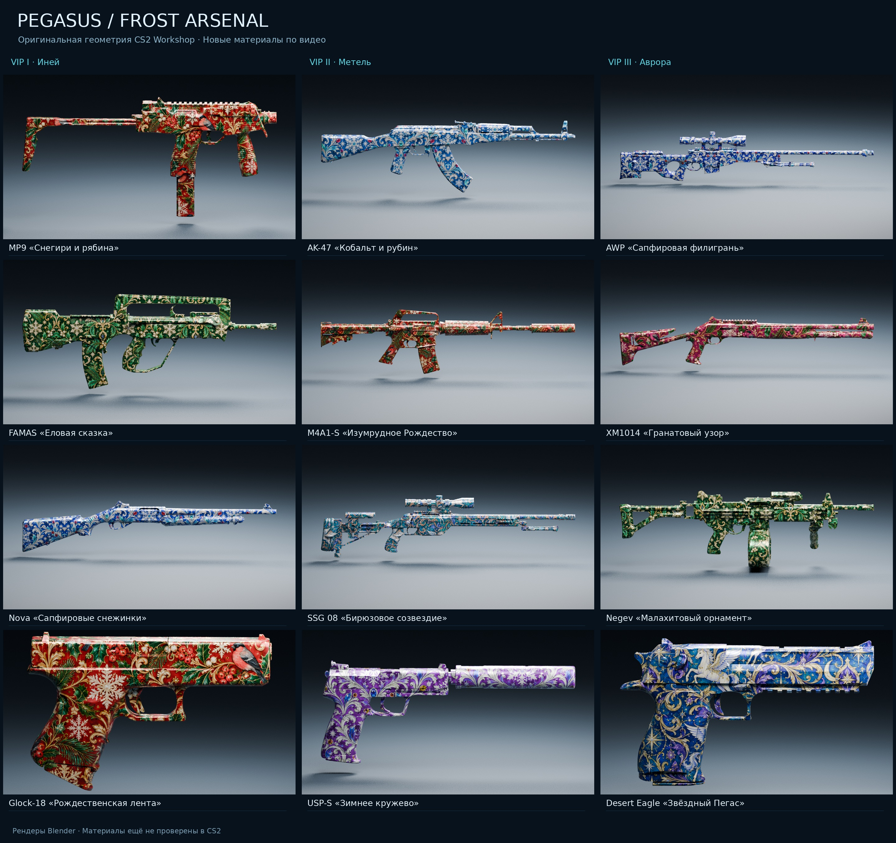

# PEGASUS CS2 — Winter VIP Arsenal

**12 зимних оружий · 3 VIP-уровня · магазин за снежинки · переливы материалов · уникальные способности**

Единый обзор всего набора: [VIP, способности, модели и фактический статус](docs/WINTER_ARSENAL_OVERVIEW_RU.md). [Автономный интерактивный HTML с изображениями внутри](preview/winter-arsenal-overview.html) позволяет переключать VIP и коллекции, искать оружие и увеличивать рендеры.

Полный пакет моделей, Blender-сцен, текстур, исходников и тестовой сборки: [PEGASUS_Frost_Arsenal_FULL.zip](archives/PEGASUS_Frost_Arsenal_FULL.zip), хранится в репозитории через Git LFS. [Инструкция скачивания](archives/README.md). Это тестовый пакет; интеграция выдачи и игровой тест CS2 ещё не завершены.

Проект ведётся отдельно от действующего сервера PEGASUS. **Статус: прототип, не готовый игровой плагин**. Здесь есть каталог и тестируемая доменная логика доступа/покупок; игровых моделей Source 2, полной реализации способностей, выдачи оружия и проверенной DLL пока нет.

## Внешний вид по видеореференсу

Новая версия визуальных материалов использует **оригинальную геометрию CS2 из официального пакета Valve Workshop**, с сохранением формы и исходных UV. Орнаменты, названия и палитры подготовлены по предоставленному видео `PEGASUS_Frost_Arsenal.mp4`.

Рендеры, новые цветовые карты, статус и инструкция воспроизведения: [assets/frost_cs2](assets/frost_cs2/README.md). Геометрия скачивается напрямую у Valve; GLB и Blender-сцены создаются локально в `assets/cs2_local/`. Материалы пока не скомпилированы и не проверены в CS2.

## Доступ и экономика

Ледяные трассеры реализованы отдельным модулем с привязкой к выданным экземплярам арсенала: [описание, предпросмотр и подключение](docs/ICY_TRACERS.md). Обычные оружия того же типа не включаются автоматически. Опорная сборка: CounterStrikeSharp.API 1.0.378 / .NET 10; подключение выдачи и проверка в CS2 ещё требуются.

| Кто играет | Бесплатно | За снежинки |
| --- | --- | --- |
| Обычный игрок | — | Все 12 оружий |
| VIP I | 4 оружия уровня I | II–III |
| VIP II | 8 оружий уровней I–II | III |
| VIP III | Все 12 | — |

Предварительные цены за **одно оружие на одну карту**: I — **150**, II — **300**, III — **600** снежинок. Цена настраивается у оружия. Покупка не обнуляет валюту при смене карты; **обнуляется только право пользоваться покупкой**, и на следующей карте требуется оплатить снова. После покупки на этой карте оружие можно **брать повторно без списания**. VIP получает бесплатно через своё VIP-меню. Нажатие «Взять» должно немедленно выдать оружие и написать в чат: `Вы взяли <название>`.

## VIP I · Иней

- MP9 «Снегирь» — ускорение после убийства.
- FAMAS «Снежный дозор» — пополнение магазина из резерва.
- Nova «Хрусталь» — броня после убийства вблизи.
- Glock-18 «Морозный импульс» — замедление за серию попаданий.

## VIP II · Метель

- AK-47 «Frostbite» — короткое замедление серией попаданий.
- M4A1-S «Blizzard» — тихие шаги после убийства.
- SSG 08 «Полярный след» — снежные следы раненой цели.
- USP-S «Призрачный иней» — короткие тихие шаги.

## VIP III · Аврора

- AWP «Ice Dragon» — ледяная зона после убийства.
- XM1014 «Вьюжный клык» — короткий отталкивающий криоимпульс.
- Negev «Вечная мерзлота» — лечебный кристалл после убийства.
- Desert Eagle «Полярная буря» — замедление за выживший headshot.

Материал на любом оружии: VIP I — мягкий бело-голубой перелив (5 с), VIP II — голубо-бирюзовые линии (3,5 с), VIP III — северное сияние (4 с). **Стиль перелива VIP определяется владельцем**. У обычного покупателя используется стиль коллекции приобретённого оружия.

## Открыть проект в Codex

1. Откройте [репозиторий Guns1](https://github.com/andrey020215-ctrl/Guns1) в Codex.
2. Дайте задание: **«Прочитай AGENTS.md и CODEX_TASK_RU.md; реализуй этап 1 по тестам, создай PR. Действующий PEGASUS не трогай.»**
3. Для предварительного просмотра откройте `preview/index.html` в браузере.
4. Конфигурация — `config/vip_weapons.concept.json`, реализация политик — `src/PegasusVipArsenal/MapWeaponStore.cs`.

## Статус проверки

- Уровни доступа, конфигурация и карта покупок: доменный код и тест-сценарии, **не интегрированы в игровое меню/валюту**.
- Переливы: браузерный визуальный прототип; движок Source 2 и производительность ещё не проверены.
- Все способности: параметры зафиксированы, реализация в CounterStrikeSharp ожидается.

Лимиты PEGASUS: 110 HP / 125 брони. Локальное подключение после отдельной тестовой установки: `connect 127.0.0.1:27015`.

## Важно: мгновенная выдача

И **покупка** обычным игроком, и **«Взять»** в VIP-меню должны выдавать и экипировать оружие сразу, не после респавна. Первая покупка автоматически включает выдачу без второго клика. Это приоритетная задача, [требование](docs/INSTANT_GRANT_RU.md) / [issue #1](https://github.com/andrey020215-ctrl/Guns1/issues/1). C# игровой grant пока не реализован.
