# PEGASUS — полный обзор зимнего арсенала

**Фактический статус:** модели и текстуры созданы, модуль трассеров собран. Выдача, применение скинов и привязка к действующей системе ролей/экономики PEGASUS ещё не интегрированы. Все 12 суперспособностей пока являются спецификацией. Игровой тест CS2 не проводился.

[Интерактивный HTML-обзор](../preview/winter-arsenal-overview.html) · [Полный архив в GitHub](https://github.com/andrey020215-ctrl/Guns1/blob/feat/winter-arsenal-prototypes/archives/PEGASUS_Frost_Arsenal_FULL.zip) · [PR #2](https://github.com/andrey020215-ctrl/Guns1/pull/2)

## Что уже получилось

| Блок | Что создано | Что ещё требуется |
|---|---|---|
| 3D и текстуры | Созданы 12 моделей на официальной геометрии Valve Workshop: GLB, редактируемые Blender-сцены, исходные OBJ и цветовые карты 2048×2048. | Геометрия и исходные UV всех 12 моделей проверены. Игровые Source 2 ресурсы не скомпилированы. |
| VIP и магазин | Есть проверяемая доменная политика доступа, покупки на одну карту и чтение локальных VIP-списков. | Роли PEGASUS, реальный баланс, игровые меню и выдача ещё не интегрированы. |
| 12 способностей | Условия, эффекты, ограничения и отдельные кулдауны описаны в каталоге. | Игровой AbilityEngine отсутствует; способности не реализованы в обработчиках CS2. |
| Ледяные трассеры | Реализован и собран модуль с привязкой к конкретному экземпляру, владельцу/pawn и эпохе карты. Прошли 121 автопроверка. | Нужны регистрация реальной выдачи со скином, resolver дульной точки и согласование с Weapon Frost Effects; в CS2 не проверено. |
| Переливы | В Blender есть мягкий автономный перелив в светлых деталях, с циклами коллекций. | GLB статический. Три полных Source 2 финиша и смена финиша по текущему VIP владельца не реализованы в игре. |
| Сборка и сервер | Плагин собран на CounterStrikeSharp.API 1.0.378 / .NET 10 без ошибок и предупреждений. | Установленная версия API PEGASUS неизвестна. Сервер не изменялся, игровых тестов нет. |

## Все модели

Использована оригинальная геометрия официального пакета Valve CS2 Workshop. Новые орнаменты созданы по стилистике видеореференса, это не извлечённые текстуры видео. На рендерах стоят имена из видео; в игровом конфиге ещё сохранены прежние названия. Ниже они сопоставлены по ID, без изменения игровых параметров.

## Привязка к трём уровням VIP

| Игрок | Бесплатных оружий | Бесплатный доступ по правилам | Остальное |
|---|---:|---|---|
| Обычный игрок | 0 | Нет | Все 12 за снежинки |
| VIP I | 4 | 4 оружия коллекции I | Коллекции II и III |
| VIP II | 8 | Коллекции I + II | Коллекция III |
| VIP III | 12 | Все три коллекции | Все 12 уже разрешены бесплатно |

Эта матрица реализована в доменной логике, но ещё не подключена к настоящим ролям PEGASUS. `VipAccess` читает локальные списки по SteamID; реальные персональные списки в репозиторий не помещаются.

## Магазин и выдача — правила

- Все 12 оружий доступны обычному игроку за снежинки; VIP не является обязательным условием покупки.
- Предварительная цена одного предмета: коллекция I — **150**, II — **300**, III — **600 снежинок**.
- Покупка действует **до следующей смены карты**. Смерть, респавн и переподключение не отменяют право повторно взять купленный предмет.
- Повторное «Взять» не списывает деньги. При смене карты сбрасываются покупки, но не баланс снежинок.
- Используется существующая экономика PEGASUS; второй кошелёк не создаётся. Реальный адаптер баланса пока отсутствует.
- По проекту покупка и VIP «Взять» должны сразу выдавать и экипировать оружие в текущей жизни, с откатом при ошибке. Эта транзакция пока не реализована.
- Чат после покупки: «Вы купили <название> за N снежинок»; после успешной выдачи: «Вы взяли <название>».
- Игровые меню пока доступны как read-only предпросмотр: `css_vipguns`, `css_wintershop`. Доменный `Buy()` сам не выдаёт оружие.

## VIP 1 · Иней — 4 предмета

Бесплатно для VIP уровня 1 и выше; для остальных — 150 снежинок за предмет на карту. Способности ниже **заданы в конфиге, но ещё не реализованы в CS2**.

### MP9 «Снегири и рябина»

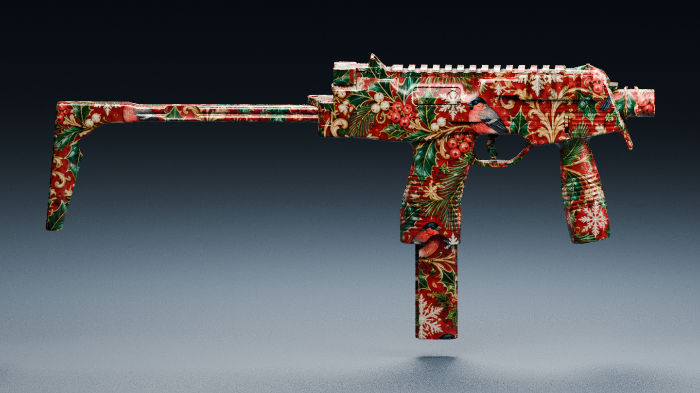

- ID: `mp9`. Имя в игровом конфиге: **MP9 «Снегирь»**.
- База: `weapon_mp9`; слот: основное оружие.
- Текущий внешний вид: Красный фон, снегири, рябина, хвоя, снежинки и золотой орнамент.
- Способность: **Зимний порыв**.
- Условие: Убийство из MP9.
- Эффект: +6% к скорости на 2 с, пока MP9 в руках.
- Кулдаун: **10 с**. Предусмотренный визуальный эффект способности: Снежная пыль.

### FAMAS «Еловая сказка»

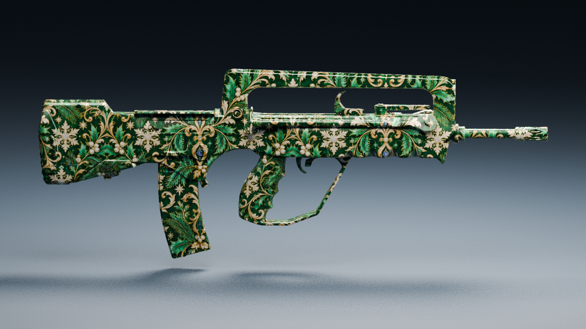

- ID: `famas`. Имя в игровом конфиге: **FAMAS «Снежный дозор»**.
- База: `weapon_famas`; слот: основное оружие.
- Текущий внешний вид: Тёмно-зелёный еловой фон, золотая филигрань и светлые снежинки.
- Способность: **Полярный резерв**.
- Условие: Убийство из FAMAS, запас патронов не пуст.
- Эффект: Перенос до 4 патронов из резерва в магазин (без увеличения ёмкости).
- Кулдаун: **8 с**. Предусмотренный визуальный эффект способности: Иней движется к магазину.

### Nova «Сапфировые снежинки»

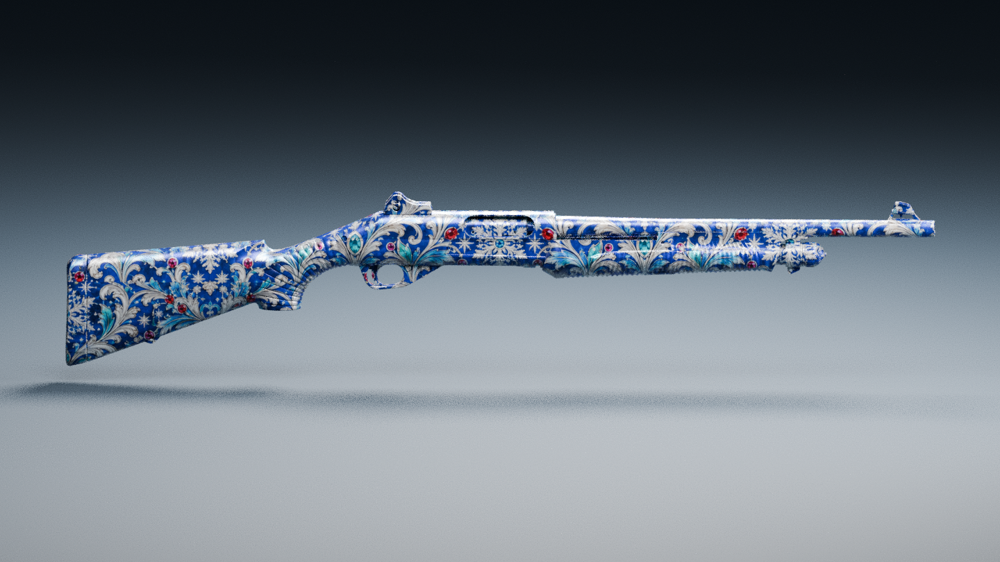

- ID: `nova`. Имя в игровом конфиге: **Nova «Хрусталь»**.
- База: `weapon_nova`; слот: основное оружие.
- Текущий внешний вид: Сапфировый фон, серебристые снежинки и завитки, бирюзовые детали.
- Способность: **Кристальный панцирь**.
- Условие: Убийство не далее 10 метров.
- Эффект: +10 брони, но не выше серверного лимита 125.
- Кулдаун: **12 с**. Предусмотренный визуальный эффект способности: Кристаллическая вспышка на перчатках.

### Glock-18 «Рождественская лента»

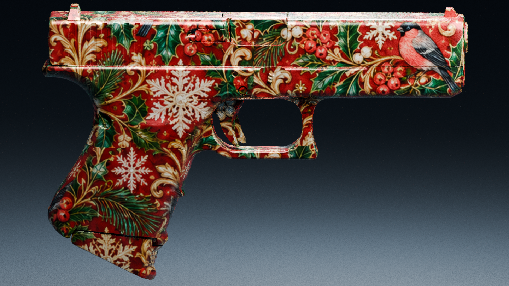

- ID: `glock18`. Имя в игровом конфиге: **Glock-18 «Морозный импульс»**.
- База: `weapon_glock`; слот: пистолет.
- Текущий внешний вид: Красно-зелёный рождественский орнамент, ягоды, хвоя и золотые завитки.
- Способность: **Морозная серия**.
- Условие: 3 попадания подряд по одной живой цели без промаха.
- Эффект: −8% скорости цели на 0,6 с, без дополнительного урона.
- Кулдаун: **12 с**. Предусмотренный визуальный эффект способности: Короткая голубая вспышка.

## VIP 2 · Метель — 4 предмета

Бесплатно для VIP уровня 2 и выше; для остальных — 300 снежинок за предмет на карту. Способности ниже **заданы в конфиге, но ещё не реализованы в CS2**.

### AK-47 «Кобальт и рубин»

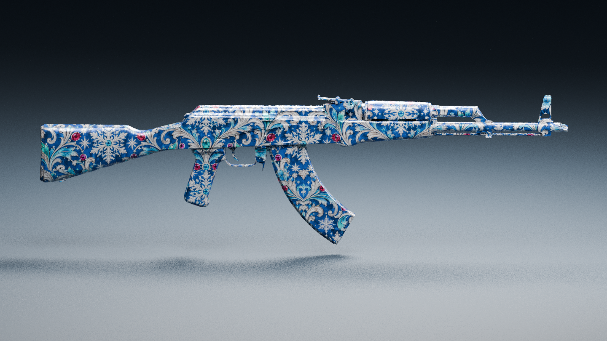

- ID: `ak47`. Имя в игровом конфиге: **AK-47 «Frostbite»**.
- База: `weapon_ak47`; слот: основное оружие.
- Текущий внешний вид: Кобальтовый фон, серебристый морозный орнамент, бирюзовые и рубиновые акценты.
- Способность: **Обморожение**.
- Условие: 3 попадания по одной цели за 1,2 с.
- Эффект: −10% скорости цели на 0,8 с, без дополнительного урона.
- Кулдаун: **10 с**. Предусмотренный визуальный эффект способности: Вспышка инея у ног врага.

### M4A1-S «Изумрудное Рождество»

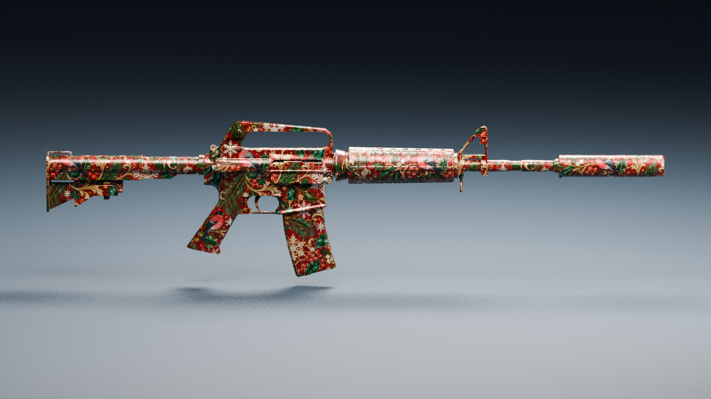

- ID: `m4a1s`. Имя в игровом конфиге: **M4A1-S «Blizzard»**.
- База: `weapon_m4a1_silencer`; слот: основное оружие.
- Текущий внешний вид: Красно-зелёный еловой орнамент с золотыми деталями, в том числе на глушителе.
- Способность: **Тихая метель**.
- Условие: Убийство из M4A1-S.
- Эффект: Собственные шаги не слышны 1,5 с при удержании M4A1-S; выстрелы слышны.
- Кулдаун: **12 с**. Предусмотренный визуальный эффект способности: Голубая волна вдоль глушителя.

### SSG 08 «Бирюзовое созвездие»

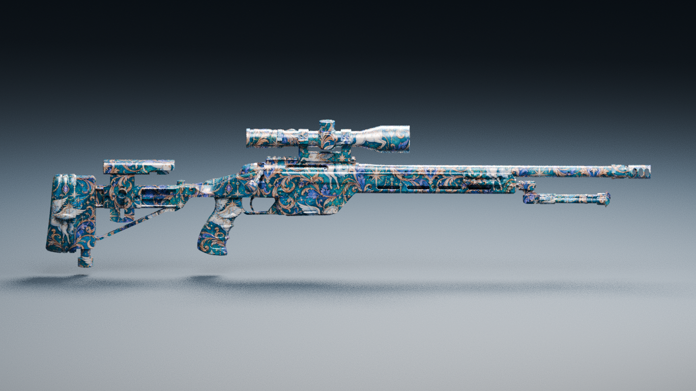

- ID: `ssg08`. Имя в игровом конфиге: **SSG 08 «Полярный след»**.
- База: `weapon_ssg08`; слот: основное оружие.
- Текущий внешний вид: Бирюзово-синий орнамент, звёзды, золотая филигрань и Пегасы.
- Способность: **Снежный след**.
- Условие: Несмертельное попадание.
- Эффект: Цель оставляет снежные следы 2 с, видимые только стрелку; без ESP через стены.
- Кулдаун: **10 с**. Предусмотренный визуальный эффект способности: Краткое сияние вдоль ложа.

### USP-S «Зимнее кружево»

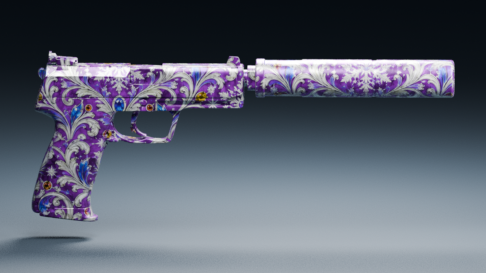

- ID: `usp_s`. Имя в игровом конфиге: **USP-S «Призрачный иней»**.
- База: `weapon_usp_silencer`; слот: пистолет.
- Текущий внешний вид: Фиолетово-серебристое зимнее кружево на корпусе и глушителе.
- Способность: **Призрачный шаг**.
- Условие: Убийство из USP-S.
- Эффект: Собственные шаги не слышны 2 с при удержании USP-S; выстрелы слышны.
- Кулдаун: **15 с**. Предусмотренный визуальный эффект способности: Бирюзовый свет по глушителю.

## VIP 3 · Аврора — 4 предмета

Бесплатно для VIP уровня 3 и выше; для остальных — 600 снежинок за предмет на карту. Способности ниже **заданы в конфиге, но ещё не реализованы в CS2**.

### AWP «Сапфировая филигрань»

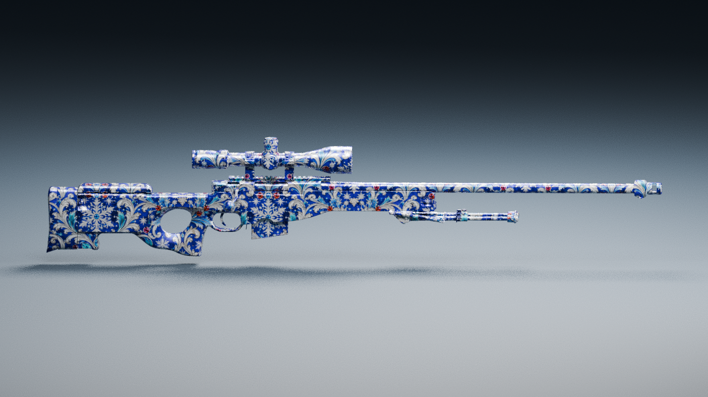

- ID: `awp`. Имя в игровом конфиге: **AWP «Ice Dragon»**.
- База: `weapon_awp`; слот: основное оружие.
- Текущий внешний вид: Сапфировые и серебристые узоры со снежинками на ложе, стволе и прицеле.
- Способность: **Ледяное эхо**.
- Условие: Убийство из AWP.
- Эффект: На 2 с зона радиусом 2 м у цели: −10% скорости врагам внутри, с проверкой видимости.
- Кулдаун: **18 с**. Предусмотренный визуальный эффект способности: Ледяное кольцо и полупрозрачный контур дракона.

### XM1014 «Гранатовый узор»

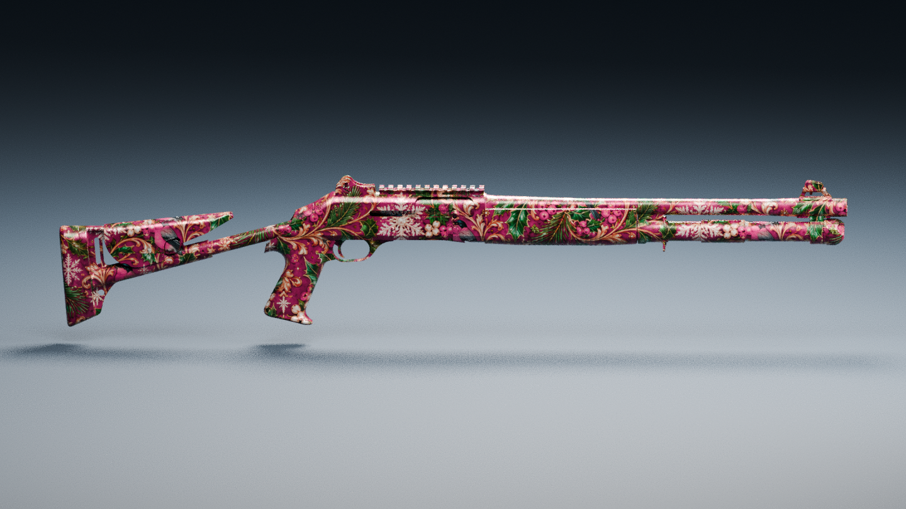

- ID: `xm1014`. Имя в игровом конфиге: **XM1014 «Вьюжный клык»**.
- База: `weapon_xm1014`; слот: основное оружие.
- Текущий внешний вид: Гранатово-красный и фиолетовый орнамент, хвоя и золотые детали.
- Способность: **Криоимпульс**.
- Условие: Первое несмертельное попадание до 6 м по стоящей на земле цели.
- Эффект: Мягкое отталкивание от стрелка до 0,7 м без оглушения.
- Кулдаун: **15 с**. Предусмотренный визуальный эффект способности: Короткая волна ледяной крошки.

### Negev «Малахитовый орнамент»

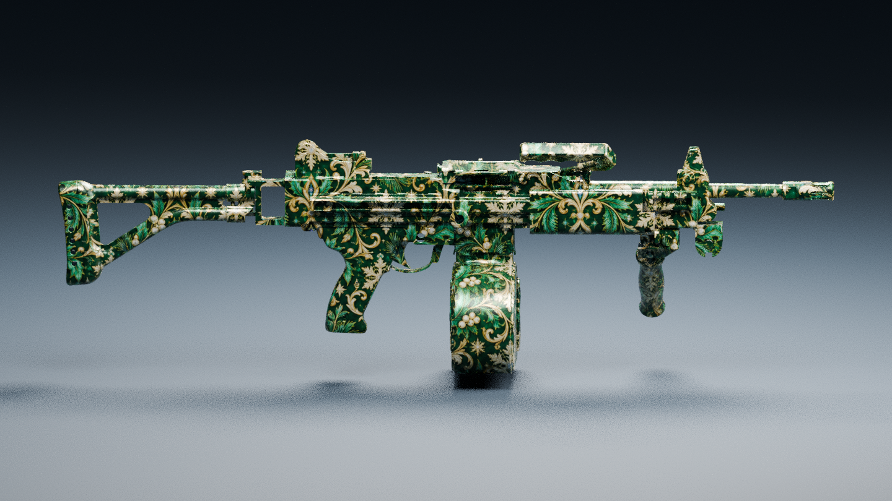

- ID: `negev`. Имя в игровом конфиге: **Negev «Вечная мерзлота»**.
- База: `weapon_negev`; слот: основное оружие.
- Текущий внешний вид: Малахитово-зелёная основа, золотой растительный орнамент и светлые снежинки.
- Способность: **Сердце зимы**.
- Условие: Убийство из Negev.
- Эффект: Кристалл на 4 с; подбор владельцем восстанавливает +20 HP, максимум 110.
- Кулдаун: **15 с**. Предусмотренный визуальный эффект способности: Падающий кристалл распадается на снежинки.

### Desert Eagle «Звёздный Пегас»

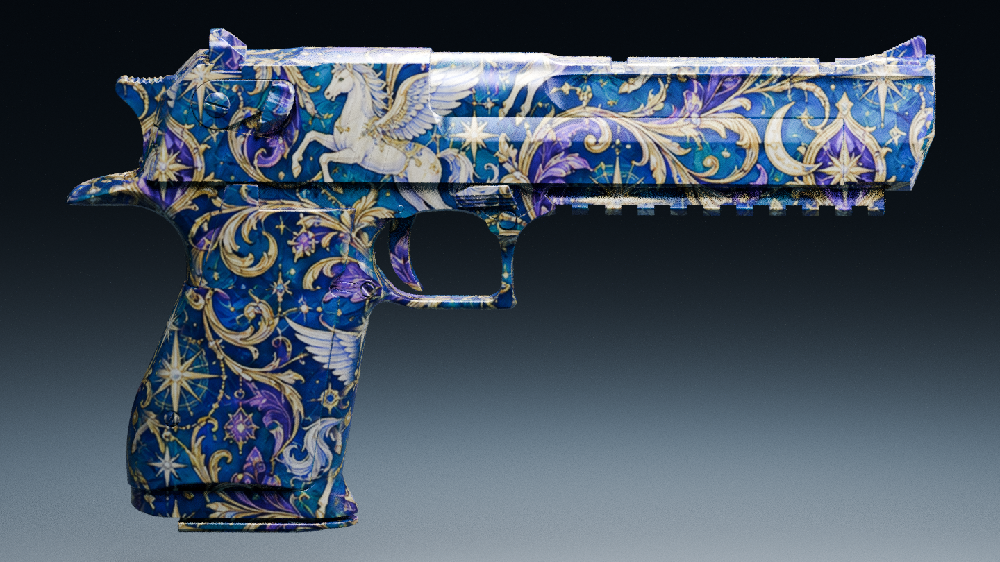

- ID: `deagle`. Имя в игровом конфиге: **Desert Eagle «Полярная буря»**.
- База: `weapon_deagle`; слот: пистолет.
- Текущий внешний вид: Сине-бирюзовый фон, белые Пегасы, звёзды, золото и фиолетовые детали.
- Способность: **Полярный удар**.
- Условие: Несмертельное попадание в голову.
- Эффект: −12% скорости цели на 0,7 с, без дополнительного урона.
- Кулдаун: **18 с**. Предусмотренный визуальный эффект способности: Волна северного сияния по затвору.

## Переливы и пределы баланса

| VIP владельца | Предусмотренный финиш | Цикл |
|---|---|---|
| VIP 1 | Иней: Бело-голубой перламутр | 5 с |
| VIP 2 | Метель: Голубые и бирюзовые прожилки | 3,5 с |
| VIP 3 | Аврора: Бирюзово-синие и фиолетовые волны северного сияния | 4 с |

- Финиш VIP-игрока должен определяться его текущим уровнем, даже на оружии младшей коллекции; для игрока без VIP используется финиш коллекции купленного оружия.
- Перелив должен двигаться и на неподвижном оружии, внутри узоров. В Blender создан предварительный мягкий эффект; полноценная реализация в Source 2 ещё впереди.
- Способности одинаковы для купленного и бесплатного VIP-варианта.
- Базовые значения по проекту — **100 HP / 100 брони**. Максимумы от эффектов — **110 HP / 125 брони**.
- Замедления не суммируются. У каждого оружия свой кулдаун. Отдельных реализованных игровых обработчиков этих правил пока нет.

## Ледяные трассеры

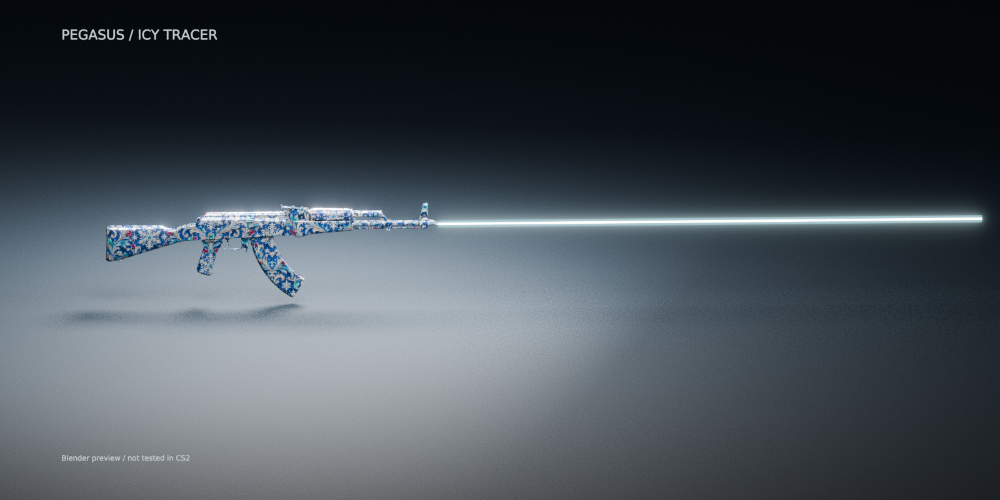

- Светлое бело-голубое ядро и голубое свечение, время жизни **0,12 с** с затуханием.
- Модуль допускает только зарегистрированный экземпляр нашего оружия: полный handle с serial, владелец/pawn, ID предмета и эпоха карты. Тип оружия или VIP сами по себе не включают эффект.
- Начало должно браться из реальной дульной точки этого экземпляра. Без доступной дульной точки эффект пропускается; позиция глаз не подставляется.
- Конец определяется по событию попадания; препятствия проверяются серверным ray trace. Нет выдуманной траектории при отсутствии `bullet_impact`.
- Поддержаны ограничения дробинок и очередей по данным оружия, защита от повторов, очистка при удалении/выходе/смерти/смене карты и лимит **192 beam-entity**.
- Не меняет урон, не подсвечивает врагов. Существующий Weapon Frost Effects должен пропускать свой трассер для этих экземпляров, чтобы не было дублей.
- Статус: код и сборка есть, **121 автопроверка прошла**. Реальная регистрация выдачи, дульный resolver и игровой тест ещё нужны.

## Файлы и подтверждение

- `assets/cs2_local/`: 12 GLB, 12 Blender-сцен; исходные OBJ — в `source/`. Эти большие файлы включены в полный архив Git LFS.
- `assets/frost_cs2/`: цветовые карты, орнаментальный атлас, 12 рендеров, общий лист и результаты проверки геометрии/UV.
- `assets/icy_tracers/`: рендер эффекта и отчёт сборки/проверок.
- `src/PegasusVipArsenal/`: доменная политика, read-only каталог и модуль трассеров; `src/PegasusVipArsenal.Contracts/` — общий API.
- `config/vip_weapons.concept.json`: все 12 записей, цены, условия и параметры способностей; `config/icy_tracers.json` — внешний вид трассера.
- Сборка: **CounterStrikeSharp.API 1.0.378 / .NET 10 / MinimumApiVersion 378**, 0 ошибок и предупреждений.
- Проверены все 12 моделей: сохранение геометрии, числа граней и исходных UV, встроенные текстуры GLB и карты 2048×2048.
- Прошли 121 проверка трассеров и существующие проверки политики покупок/каталога. Это не игровые тесты CS2.
- Полный архив хранится в `archives/PEGASUS_Frost_Arsenal_FULL.zip` через Git LFS; скачивание полного пакета с GitHub и SHA-256 проверены.

## Что требуется для рабочего сервера

1. Подключить роли VIP и существующий баланс снежинок PEGASUS.
2. Реализовать единую транзакцию покупки/выдачи/экипировки с откатом.
3. Подготовить и скомпилировать Source 2 ресурсы моделей и материалов, подключить нужные игровые риги/анимации.
4. Реализовать все 12 способностей и проверки пределов/кулдаунов в игровом движке.
5. Подключить применение финиша по VIP владельца, регистрацию экземпляров трассеров и реальные дульные точки, согласовать Weapon Frost Effects.
6. Пройти отдельный тест CS2: первое/третье лицо, 32 игрока, смена карты, респавн, отключения, очистка и производительность.

Действующий сервер PEGASUS не изменялся. Весь набор сейчас является проверенным набором 3D-материалов, доменной логики, спецификаций и собранного модуля трассеров, а не завершённой игровой установкой.
